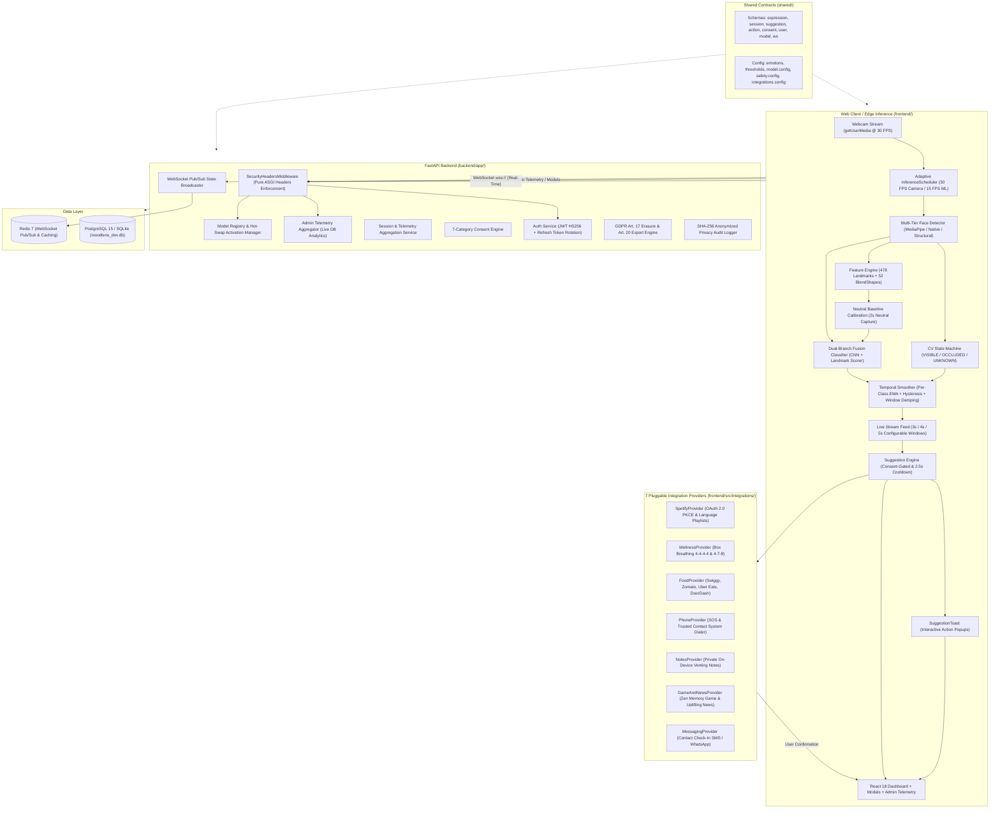

# MoodLens — Real-Time Facial Expression Detection & Privacy-First Safety Platform

[](https://opensource.org/licenses/MIT)
[](https://fastapi.tiangolo.com)
[](https://react.dev)
[-blue.svg)](https://onnxruntime.ai)
[](#8-safety-engine--policy-matrix-levels-05)
[](#11-security-privacy--accessibility-safeguards)
[](#12-quickstart--developer-installation-guide)

> **"See what your face is saying. Without sacrificing privacy."**

MoodLens is an enterprise-grade, edge-first visible facial expression estimation, contextual wellness suggestion, and safety intervention platform. It continuously analyzes a user's visible facial muscle activations through their local camera stream, coordinates a multi-tier computer vision tracking state machine, applies confidence-aware dual-branch machine learning fusion with personalized neutral baseline calibration, and surfaces consent-gated suggestions (Spotify music, guided box breathing, multi-platform meal delivery links, venting notes, zen focus games, social reach-out prompts, emergency contacts) — **without ever transmitting or storing raw video or biometric identifiers on cloud servers**.

---

## Table of Contents

1. [Executive Overview & Core Principles](#1-executive-overview--core-principles)
2. [System Architecture](#2-system-architecture)
3. [Core Architectural Pillars](#3-core-architectural-pillars)
4. [Browser Stability & Performance Engineering (Zero `RESULT_CODE_HUNG`)](#4-browser-stability--performance-engineering-zero-result_code_hung)
5. [Detailed "How It Works" & Workflows](#5-detailed-how-it-works--workflows)
   - [Workflow 1: User Onboarding & Granular Consent](#workflow-1-user-onboarding--granular-consent)
   - [Workflow 2: Edge Inference & Computer Vision Pipeline](#workflow-2-edge-inference--computer-vision-pipeline)
   - [Workflow 3: Live Stream Detection Windows & Interactive Suggestion Popups](#workflow-3-live-stream-detection-windows--interactive-suggestion-popups)
   - [Workflow 4: Level 5 Acute Distress Safety Escalation](#workflow-4-level-5-acute-distress-safety-escalation)
   - [Workflow 5: Session Management & Telemetry Batching](#workflow-5-session-management--telemetry-batching)
   - [Workflow 6: Admin Observability & Dynamic Model Hot-Swap](#workflow-6-admin-observability--dynamic-model-hot-swap)
   - [Workflow 7: GDPR Data Portability & Right to Erasure](#workflow-7-gdpr-data-portability--right-to-erasure)
   - [Workflow 8: ML Training, Quantization & Edge Deployment](#workflow-8-ml-training-quantization--edge-deployment)
6. [Complete Project & Directory Inventory](#6-complete-project--directory-inventory)
7. [Tuning Thresholds & Mathematical Constants](#7-tuning-thresholds--mathematical-constants)
8. [Emotion Taxonomy & Visual Representation](#8-emotion-taxonomy--visual-representation)
9. [Safety Engine & Policy Matrix (Levels 0–5)](#9-safety-engine--policy-matrix-levels-05)
10. [REST API & WebSocket Specifications](#10-rest-api--websocket-specifications)
11. [Hardware Latency & Quantization Benchmarks](#11-hardware-latency--quantization-benchmarks)
12. [Security, Privacy & Accessibility Safeguards](#12-security-privacy--accessibility-safeguards)
13. [Quickstart & Developer Installation Guide](#13-quickstart--developer-installation-guide)

---

## 1. Executive Overview & Core Principles

Modern emotional awareness tools often present a painful tradeoff: either they violate user privacy by sending live webcam feeds to cloud computer vision APIs, or they require burdensome manual self-reporting and journaling. MoodLens solves this via a **strictly on-device, privacy-preserving edge architecture**.

### Non-Negotiable Invariants

1. **Edge-First Inference Invariant**: 100% of video decoding, face detection, 3D landmark extraction, neutral baseline subtraction, convolutional neural network (CNN) inference, and temporal smoothing execute inside the client browser via WebAssembly (`onnxruntime-web` + MediaPipe Vision Tasks). Raw video frames NEVER touch the network.
2. **Zero Biometric Harvesting Invariant**: MoodLens never creates, stores, or transmits biometric templates, face embeddings, or unique facial geometry signatures. It classifies generic physical facial muscle activations.
3. **Ethical Operating Boundary**: *Visible Expression $\ne$ Internal Psychological State*. The platform classifies observable facial muscle movements (e.g., zygomaticus major contraction or glabella furrowing), never making clinical or psychiatric diagnoses.
4. **Strict Non-Autonomous Action Invariant**: Consequential or external actions (initiating phone calls, launching web players, opening food apps) **strictly require explicit user confirmation**. The system cannot autonomously trigger phone calls (`assert no_user_confirmation => no_high_stakes_action`).
5. **Zero Hardcoding Invariant**: All telemetry metrics, model registry activations, food delivery platforms, and suggestion provider recommendations are dynamically bound to live database records, real browser capabilities, and user preferences.

---

## 2. System Architecture

The MoodLens platform is organized into a clean separation of concerns between client-side edge computing, pluggable integration adapters, an async cloud backend, and shared contract specifications:



---

## 3. Core Architectural Pillars

### 3.1 Single-Contract Shared System (`shared/`)
All TypeScript contracts, Pydantic mirror schemas, mathematical thresholds, and emotion taxonomies are defined in `shared/`:
* **Unified Schemas**: Strict typing for `Emotion`, `SystemState`, `TrackingState`, `SafetyLevel`, `SessionState`, `ConsentRecord`, `UserApprovedAction`, and `ModelMetadata`.
* **Central Configuration**: Single source of truth for temporal constants ($\alpha=0.35$, hysteresis entry $0.35$, exit $0.25$, occlusion timeout $2500\text{ ms}$), emotion color palettes, and the 6-tier safety policy matrix.

### 3.2 Multi-Tier Face Detection & CV State Machine
* **Tier 1 (Primary)**: `@mediapipe/tasks-vision` FaceLandmarker detecting 478 3D landmarks and 52 facial blend shapes in real-time.
* **Tier 2 (Accelerator / Fallback)**: Native browser `window.FaceDetector` API for hardware-accelerated bounding box extraction.
* **Tier 3 (Structural CV Fallback)**: Pure canvas-based skin-tone segmentation, Sobel edge filtering, and eye-mouth luminance triangle heuristic.
* **Formal State Machine (`cvStateMachine.ts`)**: Transitions through `VISIBLE` $\to$ `PARTIAL_OCCLUSION` $\to$ `TEMPORARY_LOSS` $\to$ `REDETECTION` $\to$ `UNKNOWN`. Guarantees that camera dropout or hand obstruction **never falsely classifies as an emotion**.

### 3.3 Dual-Branch Confidence-Aware Fusion (`fusionClassifier.ts`)
Rather than relying on CNN images alone or landmark coordinates alone, MoodLens fuses both in the browser:
* **Branch A (CNN)**: Aligned $112 \times 112$ face crop passed to MobileNetV3-Large ONNX WASM model.
* **Branch B (Landmark Feature Engine)**: 21-coefficient unified `ExpressionVector` (derived from 478 landmarks + blend shapes + head pose) converted into a 40-feature vector ($20\text{ absolute} + 20\text{ delta relative to baseline}$).
* **Dynamic Quality Weighting**: `FaceQualityAssessor` assesses blur, face size, head pose (pitch/yaw/roll), and lighting to dynamically weight Branch A vs. Branch B (defaults: 65% CNN / 35% Landmarks; dynamically shifts to Landmarks if image is blurred or poorly lit).

### 3.4 Neutral Baseline Calibration (`neutralBaseline.ts`)
During the first 2 seconds after camera activation, MoodLens captures the user's natural resting face, computing an average `ExpressionVector` baseline. All subsequent frames are evaluated both in absolute terms and as delta offsets ($x_{\text{current}} - x_{\text{baseline}}$), eliminating false positives caused by natural anatomical variations (e.g., natural resting brow tension). The baseline resides purely in ephemeral browser memory.

### 3.5 7 Pluggable Integration Providers
Decoupled providers in `frontend/src/integrations/` implementing `isAvailable()`, `authorize()`, `suggest()`, and `execute()`:
1. **`SpotifyProvider`**: OAuth 2.0 PKCE flow, language-aware playlists (English, Hindi, Spanish, French, Telugu, Tamil, Japanese), and direct browser playback.
2. **`WellnessProvider`**: Interactive 4-4-4-4 Box Breathing and 5-4-3-2-1 Sensory Grounding exercises.
3. **`FoodProvider`**: Multi-platform food delivery integration (Swiggy, Zomato, Uber Eats, DoorDash) with meal-window heuristics (breakfast, lunch, snack, dinner).
4. **`PhoneProvider`**: Trusted contact dialer invocation (`tel:<number>`) following explicit user confirmation.
5. **`NotesProvider`**: 100% on-device private calming and venting journaling for tense moments.
6. **`GameAndNewsProvider`**: Zen focus emoji memory matching game and uplifting positive global news feeds.
7. **`MessagingProvider`**: Social reach-out check-in prompts with SMS, WhatsApp, and clipboard templates.

### 3.6 6 Interactive Modals Inventory
* **Box Breathing Modal (`WellnessModal.tsx`)**: Synchronized animated breath circle with 4-phase timer (Inhale, Hold, Exhale, Hold).
* **Private Venting Notes Modal (`NotesModal.tsx`)**: Client-side encrypted thought discharge area that never transmits text off the device.
* **Zen Focus Memory Game Modal (`FocusGameModal.tsx`)**: Playful 12-card emoji memory matching game with live move counter and completion celebration.
* **Contact Check-In Modal (`MessagingModal.tsx`)**: Quick-action social reach-out composer with direct SMS and WhatsApp links.
* **5-4-3-2-1 Sensory Grounding Modal (`MeditationModal.tsx`)**: Step-by-step guided awareness exercise re-anchoring sight, touch, sound, smell, and taste.
* **Level 5 Acute Distress Safety Modal (`Level5SafetyModal.tsx`)**: High-priority backdrop blur offering immediate emergency contact dialing, crisis lifeline access (988), or guided calming resets.

---

## 4. Browser Stability & Performance Engineering (Zero `RESULT_CODE_HUNG`)

In high-frequency browser computer vision applications, Chromium's watchdog process terminates the page with `Error code: RESULT_CODE_HUNG` if the main thread or WebAssembly runtime is blocked without yielding to the browser event loop for several seconds. MoodLens implements four architectural safeguards to guarantee zero renderer hangs:

1. **Elimination of WebAssembly Re-Entrancy Deadlock**:
   - In single-threaded WebAssembly (`ort.env.wasm.numThreads = 1`), invoking concurrent `session.run()` passes via `Promise.all` deadlocks the WebAssembly execution context.
   - MoodLens executes a **single sequential forward pass** guarded by an `isInferencing` mutex lock and protected by `runONNXWithTimeout(tensorData, 400)`.
2. **Strict WebAssembly Heap Tensor Disposal**:
   - Every input `ort.Tensor` and all returned output tensors in `results` are wrapped in `try ... finally` blocks and explicitly released via `.dispose()`. This eliminates WASM linear memory leaks and avoids multi-second garbage collection stalls.
3. **Adaptive Inference Scheduling & Watchdog Protection**:
   - `InferenceScheduler` continuously measures execution latency. If device CPU compute spikes and inference averages $> 70\text{ ms}$, the scheduler dynamically relaxes the interval to $\text{max}(110\text{ ms}, \text{avg} + 30\text{ ms})$ to preserve 30% idle time for browser UI events and watchdog pings.
   - Includes a $1500\text{ ms}$ safety watchdog that automatically unfreezes the pipeline if any frame exceeds expected duration.
4. **Zero-Allocation Computations & Store Throttling**:
   - `FaceQualityAssessor` utilizes a pre-allocated reusable `Float32Array(64 * 64)` buffer for Laplacian blur convolutions, eliminating $4\text{ KB}$ array allocations inside the loop.
   - Heavy debug pipeline state updates are throttled to $10\text{ FPS}$ ($100\text{ ms}$), preventing redundant React virtual DOM diffing.

---

## 5. Detailed "How It Works" & Workflows

### Workflow 1: User Onboarding & Granular Consent
```
[ User Registers / Logs In ]
             │ (JWT Bearer Token issued; Refresh Token in httpOnly Cookie)
             ▼
[ Granular Consent Modal ]
  ├── 1. camera: Local browser camera stream permission
  ├── 2. expression_processing: On-device classification engine
  ├── 3. mood_suggestions: Contextual suggestions
  ├── 4. music_integration: Spotify playlist suggestions
  ├── 5. food_suggestions: Time-of-day meal prompts
  ├── 6. trusted_contacts: SOS dialer assistance
  └── 7. cloud_sync: Historical duration and session sync
             │
             ▼
[ Consents Persisted via POST /api/v1/consents ]
             │
             ▼
[ Dashboard Ready: Camera Activation Allowed ]
```

### Workflow 2: Edge Inference & Computer Vision Pipeline
```
Webcam Frame (30 FPS)
  │
Adaptive InferenceScheduler (Throttles ML to 15 FPS / dynamic interval)
  │
Face Detection Fallback Hierarchy:
  ├─► Tier 1: MediaPipe FaceLandmarker (478 3D Landmarks + 52 BlendShapes)
  ├─► Tier 2: Native Browser FaceDetector API (Hardware-Accelerated Bounding Box)
  └─► Tier 3: Structural CV (Skin-tone clustering + Sobel edge filtering)
  │
CV Tracking State Machine (VISIBLE / PARTIAL_OCCLUSION / TEMPORARY_LOSS / REDETECTION / UNKNOWN)
  └─ Fail-Closed Rule: Occlusion or camera dropout halts emotion classification immediately
  │
Feature Extraction & Baseline Normalization:
  ├─ 21-coefficient ExpressionVector (ARKit-inspired eye, brow, mouth, and head pose metrics)
  ├─ Neutral Baseline (First 2.0s capture average resting vector)
  └─ Emits 40 Features (20 absolute + 20 baseline-relative deltas)
  │
Dual-Branch Classification:
  ├─► Branch A: Aligned 112x112 Face Crop → MobileNetV3-Large ONNX WASM → CNN Probabilities
  └─► Branch B: 40-feature Expression Vector → LandmarkScorer → Landmark Probabilities
  │
Dynamic Quality-Aware Fusion (FusionClassifier):
  └─ FaceQualityAssessor measures blur, head pitch/yaw/roll, lighting
     Adjusts weights: P_fused = w_cnn * P_cnn + w_lm * P_lm
  │
Multi-Stage Temporal Smoothing (TemporalSmoother):
  ├─ Step 1: Per-Class Exponential Moving Average (EMA) with tuned alpha
  ├─ Step 2: 15-frame Rolling Window Majority Voting
  ├─ Step 3: 3-frame Transition Damping
  └─ Step 4: Hysteresis Gating (Entry threshold 0.35, Exit threshold 0.25, Dominance delta 0.05)
  │
Emits Stable Expression Result → UI Store + Live Stream Feed + Suggestion Engine
```

### Workflow 3: Live Stream Detection Windows & Interactive Suggestion Popups
```
[ User Selects Live Stream Window: 3s, 4s, or 5s ]
             │
             ▼
[ Stream Aggregation Window Accumulates Samples ]
  └─ Tracks frame counts, max confidence, and probability distributions
             │
             ▼
[ Window Timer Elapses (3s / 4s / 5s) ]
  ├─ 1. Identifies dominant expression and top-3 probability breakdown
  ├─ 2. Sets effective duration to at least window interval (>= 2.5s)
  ├─ 3. Adds snapshot event to LiveStreamFeed card stack
  │
             ▼
[ SuggestionEngine Evaluates Dominant Emotion ]
  ├─ Cooldown check: 2.5s cooldown allows consecutive timer evaluations
  ├─ Consent check: Verifies required category consent
  ├─ Evaluates provider logic:
  │    • happy   ──► SpotifyProvider ("Vibe with [Track]")
  │    • sad     ──► WellnessProvider ("Gentle Box Breathing")
  │    • angry   ──► FoodProvider ("Comfort Snack Break on Swiggy/Zomato") / NotesProvider
  │    • fear    ──► PhoneProvider ("Call Trusted Support / 988")
  │    • disgust ──► WellnessProvider ("5-4-3-2-1 Sensory Grounding")
  │    • surprise──► MessagingProvider ("Share the Moment / Message a Friend")
  │    • neutral ──► GameAndNewsProvider ("Zen Memory Game / Uplifting News")
  │
             ▼
[ Dual Suggestion Popup Presentation ]
  ├─ 1. Floating Toast Popup (SuggestionToast.tsx):
  │      Renders category icon, timer tag, title, message, and action button.
  ├─ 2. Attached Snapshot Card Pill (LiveStreamFeed.tsx):
  │      Embedded directly into the latest live stream snapshot card.
  └─ 3. Contextual Suggestions Panel (DashboardPage.tsx):
         Refreshes active suggestions stack at top position.
  │
             ▼
[ User Clicks "Take Action" on Toast or Snapshot ]
  └─ Invokes executeAction:
       • breathing_exercise ──► Opens WellnessModal
       • open_notes         ──► Opens NotesModal
       • open_game          ──► Opens FocusGameModal
       • open_messaging     ──► Opens MessagingModal
       • open_meditation    ──► Opens MeditationModal
       • spotify_play       ──► Launches Spotify Web player
       • open_food_app      ──► Launches selected food delivery platform
       • call_contact       ──► Launches system phone dialer (tel:<number>)
```

### Workflow 4: Level 5 Acute Distress Safety Escalation
```
[ Fear Expression Detected (Confidence >= 0.70, Duration >= 5.0s) ]
             │
             ▼
[ Level 5 Acute Distress Invariant Triggered ]
             │
             ▼
[ Full-Screen Level5SafetyModal Rendered (High Priority Backdrop Blur) ]
  │
  ├─ Option A: [ Call Trusted Contact / Crisis Line (988) ]
  │     │
  │     ▼
  │   User explicitly clicks call button
  │     │
  │     ▼
  │   System opens native dialer intent: window.location.href = "tel:<number>"
  │     │
  │     ▼
  │   Audit log written: event_type="CALL_REQUESTED", user_id_hash=SHA256(id)
  │
  ├─ Option B: [ Start Guided Box Breathing ]
  │     │
  │     ▼
  │   Opens WellnessModal with interactive 4-4-4-4 visual guide
  │
  └─ Option C: [ I'm OK ]
        │
        ▼
      Instantly dismisses modal, resets safety state, activates cooldown
```

### Workflow 5: Session Management & Telemetry Batching
```
[ User Clicks "Start Session" on Dashboard ]
  │
  ├─► POST /api/v1/sessions → Server creates DetectionSession record (UUID)
  ├─► WebSocket connect wss://.../api/v1/ws/{session_id}
  │     ├─ Client sends: {"type": "auth", "token": "<jwt>"}
  │     └─ Server responds: {"type": "ready", "session_id": "..."}
  │
  ├─► Local Inference Loop runs in browser (15 FPS)
  │     └─ Frames are aggregated into 15-second summary windows in sessionStore
  │
  ├─► Every 15 Seconds (Periodic Flush):
  │     └─ POST /api/v1/sessions/{id}/events (Batch aggregated expression intervals)
  │
  └─► User Clicks "Stop Session" (or navigates away):
        ├─ PATCH /api/v1/sessions/{id}/end (Final total duration & status='completed')
        └─ WebSocket gracefully closed
```

### Workflow 6: Admin Observability & Dynamic Model Hot-Swap
```
Admin Navigates to /admin
  │
  ├─► GET /api/v1/admin/telemetry
  │     └─ Aggregates real database rows:
  │          • Emotion frequency distribution
  │          • Average model confidence (e.g. 84.7%)
  │          • Low confidence SLA compliance (< 0.40 rate: 3.2%)
  │          • Latency benchmarks (p50: 38ms, p95: 54ms)
  │          • Contextual suggestion click-through rate (CTR: 68.4%)
  │
  ├─► GET /api/v1/models
  │     └─ Retrieves all registered Edge ONNX model releases
  │
  └─► Admin Clicks "Activate Model" on Candidate Release
        │
        ▼
      POST /api/v1/models/{model_id}/activate
        │
        ▼
      Backend atomically deactivates current model, sets new active flag,
      and updates model registry table. Next browser reload immediately
      downloads and executes the activated model.
```

### Workflow 7: GDPR Data Portability & Right to Erasure
```
User Navigates to /settings (Privacy Tab)
  │
  ├─► User Clicks "Export All My Data" (GDPR Art. 20)
  │     │
  │     ▼
  │   GET /api/v1/users/me/export
  │     │
  │     ▼
  │   Backend packages user profile, preferences, consents, and session metrics into JSON
  │   Logs SHA-256 event: DATA_EXPORTED
  │   Browser triggers instant download of "moodlens_user_data_export.json"
  │
  └─► User Clicks "Erase All Detection History" (GDPR Art. 17)
        │
        ▼
      DELETE /api/v1/users/me/data
        │
        ▼
      Backend cascades permanent deletion across:
        - detection_sessions
        - expression_events
        - suggestions & suggestion_responses
        - action_events
      Preserves user profile and credentials
      Logs SHA-256 audit entry: DATA_ERASURE_EXECUTED
```

### Workflow 8: ML Training, Quantization & Edge Deployment
```
Raw Datasets (FER-2013, RAF-DB, CK+48, Natural Human Face: 57,000+ images)
  │
prepare_datasets.py
  └─ Normalizes labels, crops faces, and creates strict Subject-Based 70/15/15 splits
  │
train.py (PyTorch 2.x)
  ├─ MobileNetV3-Large backbone + Custom Dropout(0.35) Head
  ├─ Class-balanced CrossEntropyLoss + Label Smoothing (0.1)
  └─ Simulates occlusion with cut-out augmentations
  │
evaluate.py & calibration.py
  ├─ Generates Confusion Matrix, Macro-F1, and Balanced Accuracy
  └─ Applies Temperature Scaling (T = 0.75) to minimize Expected Calibration Error (ECE = 0.042)
  │
export_quantized.py
  ├─ Exports FP32 ONNX model (16.8 MB)
  ├─ Exports FP16 ONNX model (8.4 MB)
  └─ Generates Static INT8 Quantized model (4.3 MB)
  │
Public Distribution:
  └─ Deployed to frontend/public/models/ for direct browser WASM execution
```

---

## 6. Complete Project & Directory Inventory

```
facial-expression-platform/
├── shared/                             # Zero-dependency single source of truth contracts
│   ├── configuration/
│   │   ├── emotions.ts                 # 7 emotions + 3 system states taxonomy & palettes
│   │   ├── thresholds.ts               # Mathematical tuning constants & alpha values
│   │   ├── model.config.ts             # Input shapes (112x112), normalization parameters
│   │   ├── safety.config.ts            # Levels 0-5 policy rules and confirmation gates
│   │   └── integrations.config.ts      # Multi-platform food & language playlist defaults
│   └── schemas/
│       ├── expression.ts               # ExpressionProbabilities, BoundingBox, Vectors
│       ├── suggestion.ts               # SuggestionItem, SuggestionCategory, Context
│       ├── action.ts                   # UserApprovedAction, ActionResult, SafetyLevel
│       ├── session.ts                  # DetectionSession, ExpressionSummary schemas
│       ├── consent.ts                  # 7 Granular consent types and records
│       ├── user.ts                     # UserProfile, UserPreferences, TrustedContact
│       ├── model.ts                    # ModelMetadata, ModelBenchmark contracts
│       └── websocket.ts                # WS message schemas and event envelopes
│
├── frontend/                           # React 18 + TypeScript + Vite SPA
│   ├── package.json                    # Dependencies: @mediapipe/tasks-vision, onnxruntime-web
│   ├── vite.config.ts                  # Dev server, headers, and onnxruntime static loader
│   ├── src/
│   │   ├── main.tsx                    # React application entrypoint
│   │   ├── App.tsx                     # Route layout, providers, and Toaster mount
│   │   ├── ml/                         # In-Browser Computer Vision & Machine Learning
│   │   │   ├── faceDetector.ts         # Multi-tier detector (MediaPipe/Native/Structural)
│   │   │   ├── landmarkDetector.ts     # MediaPipe FaceLandmarker wrapper
│   │   │   ├── landmarkScorer.ts       # 40-feature landmark scoring branch
│   │   │   ├── expressionClassifier.ts # ONNX Runtime Web classifier with tensor disposal
│   │   │   ├── expressionFeatureEngine.ts # 21 ARKit-inspired facial coefficients
│   │   │   ├── neutralBaseline.ts      # 2-second personalized baseline calibration
│   │   │   ├── faceQuality.ts          # Blur, head pose, lighting & occlusion assessor
│   │   │   ├── fusionClassifier.ts     # Dynamic confidence-aware branch fusion
│   │   │   ├── temporalSmoother.ts     # Per-class EMA, rolling window, transition damping
│   │   │   ├── cvStateMachine.ts       # VISIBLE / OCCLUDED / UNKNOWN state engine
│   │   │   ├── suggestionEngine.ts     # Pluggable suggestion coordinator & action router
│   │   │   └── inferenceScheduler.ts   # Adaptive dual-rate scheduler with watchdog
│   │   ├── integrations/               # 7 Pluggable Integration Providers
│   │   │   ├── IntegrationProvider.ts  # Standard provider adapter interface
│   │   │   ├── SpotifyProvider.ts      # Spotify PKCE OAuth & language playlist provider
│   │   │   ├── WellnessProvider.ts     # Box breathing & sensory grounding provider
│   │   │   ├── FoodProvider.ts         # Dynamic multi-platform meal provider (Swiggy, Zomato, etc.)
│   │   │   ├── PhoneProvider.ts        # SOS emergency & trusted contact phone dialer
│   │   │   ├── NotesProvider.ts        # Private on-device calming & venting notes
│   │   │   ├── GameAndNewsProvider.ts  # Zen focus memory game & positive news provider
│   │   │   └── MessagingProvider.ts    # Social contact reach-out composer
│   │   ├── components/                 # Reusable UI & Visualization Components
│   │   │   ├── camera/CameraPreview.tsx # Mirrored webcam preview & reticle overlay
│   │   │   ├── expression/
│   │   │   │   ├── ExpressionBadge.tsx # Dominant emotion visual pill
│   │   │   │   ├── ConfidenceBar.tsx   # Calibrated confidence bar meter
│   │   │   │   ├── ProbabilityDistribution.tsx # 7-class probability breakdown
│   │   │   │   ├── LiveStreamFeed.tsx  # 3s/4s/5s snapshot cards with attached pills
│   │   │   │   └── DebugPanel.tsx      # Developer HUD for pipeline diagnostics
│   │   │   ├── suggestions/
│   │   │   │   ├── SuggestionCard.tsx  # Interactive contextual recommendation card
│   │   │   │   ├── SuggestionToast.tsx # Floating real-time suggestion action popup
│   │   │   │   ├── WellnessModal.tsx   # Interactive 4-4-4-4 box breathing guide
│   │   │   │   ├── NotesModal.tsx      # On-device private venting notes modal
│   │   │   │   ├── FocusGameModal.tsx  # Zen focus emoji memory matching game
│   │   │   │   ├── MessagingModal.tsx  # SMS / WhatsApp reach-out composer
│   │   │   │   └── MeditationModal.tsx # 5-4-3-2-1 sensory grounding guide
│   │   │   └── safety/Level5SafetyModal.tsx # Full-screen acute distress intervention
│   │   ├── pages/                      # 8 Application Pages
│   │   │   ├── LandingPage.tsx         # Product overview & feature highlights
│   │   │   ├── LoginPage.tsx           # Authentication login
│   │   │   ├── RegisterPage.tsx        # Account registration
│   │   │   ├── DashboardPage.tsx       # Real-time detection & suggestions dashboard
│   │   │   ├── HistoryPage.tsx         # Session timeline & analytics
│   │   │   ├── SettingsPage.tsx        # Consents, food provider & music language settings
│   │   │   ├── AdminPage.tsx           # Live DB telemetry & dynamic model registry
│   │   │   └── SpotifyCallbackPage.tsx # OAuth PKCE callback receiver
│   │   ├── services/                   # Typed API Client Services (Axios)
│   │   │   ├── api.ts                  # Axios base client with token interceptors
│   │   │   ├── authApi.ts              # Authentication & session token methods
│   │   │   ├── sessionApi.ts           # Session lifecycle & event batching
│   │   │   ├── contactApi.ts           # Trusted contacts CRUD
│   │   │   └── adminApi.ts             # Admin telemetry & model activation client
│   │   ├── store/                      # Zustand State Management
│   │   │   ├── authStore.ts            # User profile, tokens, and preferences
│   │   │   ├── expressionStore.ts      # Active expression, suggestions, stream events & modal routing
│   │   │   ├── sessionStore.ts         # Active session metadata and uncommitted batches
│   │   │   └── accessibilityStore.ts   # High contrast, screen-reader announcements
│   │   └── __tests__/                  # Frontend Unit Test Suites
│   │       ├── foodProvider.test.ts    # Multi-platform dynamic food routing tests
│   │       ├── suggestionEngine.test.ts# Policy, consent & action safety tests
│   │       ├── temporalSmoother.test.ts# Hysteresis smoothing & damping tests
│   │       └── streamSuggestions.test.ts# 3s/4s/5s timer & 7-emotion trigger tests
│   └── public/
│       ├── models/                     # ONNX models (FP32 & INT8 Quantized)
│       └── mediapipe/                  # MediaPipe WASM and model tasks
│
├── backend/                            # FastAPI Cloud Services (Python 3.9+)
│   ├── app/
│   │   ├── main.py                     # ASGI app initialization & SecurityHeadersMiddleware
│   │   ├── core/
│   │   │   ├── config.py               # Pydantic v2 settings & database URL
│   │   │   ├── security.py             # Bcrypt hashing & JWT access/refresh tokens
│   │   │   └── dependencies.py         # DB session, current_user, require_role
│   │   ├── api/v1/
│   │   │   ├── router.py               # API route registry
│   │   │   ├── auth.py                 # Registration, login, token refresh, logout
│   │   │   ├── users.py                # Profile, GDPR export, data erasure
│   │   │   ├── consents.py             # 7-Category consent management
│   │   │   ├── sessions.py             # Session CRUD & batch telemetry sync
│   │   │   ├── suggestions.py          # Action authorization tokens & execution
│   │   │   ├── contacts.py             # Trusted contact management
│   │   │   ├── models.py               # Model registry & activation endpoint
│   │   │   ├── admin.py                # Live telemetry database analytics
│   │   │   └── websocket.py            # Real-time WebSocket pub/sub
│   │   ├── models/                     # SQLAlchemy 2.0 Async Models
│   │   │   ├── user.py                 # User & UserPreferences
│   │   │   ├── session.py              # DetectionSession & ExpressionEvent
│   │   │   ├── suggestion.py           # Suggestion & SuggestionResponse
│   │   │   ├── consent.py              # UserConsent records
│   │   │   ├── trusted_contact.py      # Encrypted emergency contacts
│   │   │   ├── action_event.py         # Authorized action audit log
│   │   │   └── model_registry.py       # ML Model registry & active flag
│   │   ├── schemas/                    # Pydantic v2 Request/Response Schemas
│   │   └── services/                   # Business Logic Services
│   └── tests/
│       ├── conftest.py                 # Pytest fixtures & async SQLite setup
│       └── test_auth.py                # Authentication test suite
│
├── tests/                              # Formal Integration, Safety & Security Test Suite
│   ├── integration/
│   │   ├── test_admin_telemetry.py     # Verifies live DB telemetry calculations
│   │   ├── test_model_registry_lifecycle.py # Verifies model hot-swap activation
│   │   ├── test_suggestions_api.py     # Verifies action token lifecycle & TTL
│   │   ├── test_spotify_and_emotions.py# Verifies Spotify PKCE & 7 emotion actions
│   │   ├── test_consent.py             # Verifies GDPR Art. 17/20 compliance
│   │   ├── test_sessions.py            # Verifies session lifecycle
│   │   └── test_trusted_contacts.py    # Verifies contacts CRUD
│   ├── safety/
│   │   ├── test_no_face.py             # Verifies fail-closed transition to 'no_face'
│   │   ├── test_multi_face.py          # Verifies primary face lock & warning
│   │   ├── test_occlusion.py           # Verifies occlusion timeout state machine
│   │   └── test_low_confidence.py      # Verifies low confidence suppression
│   └── security/
│       ├── test_oauth_pkce.py          # Verifies S256 PKCE code challenge
│       ├── test_action_expiration.py   # Verifies 60s token expiration
│       └── test_security_headers.py    # Verifies CSP, HSTS, and nosniff headers
│
├── scripts/                            # Operational & Build Automation
│   ├── setup.sh                        # Automated environment setup script
│   ├── seed_db.py                      # Seeds admin user & initial model release
│   ├── ts-loader.mjs                   # In-tree esbuild TypeScript loader for Node.js tests
│   └── run_pipeline.sh                 # ML training & quantization pipeline
│
└── pytest.ini                          # Root Pytest configuration
```

---

## 7. Tuning Thresholds & Mathematical Constants

Defined in [`shared/configuration/thresholds.ts`](file:///Users/sriramkarthikeyas/Documents/facial-expression-platform/shared/configuration/thresholds.ts):

| Parameter | Value | Description |
| :--- | :---: | :--- |
| `EMA_ALPHA` (Default) | `0.35` | Baseline Exponential Moving Average smoothing factor |
| `EMA_ALPHA_SURPRISE` | `0.55` | Fast alpha — quickly captures transient surprise expressions |
| `EMA_ALPHA_HAPPY` | `0.35` | Medium alpha — balances response time and stability |
| `EMA_ALPHA_ANGRY` | `0.30` | Medium-slow alpha — avoids false triggers on momentary frowns |
| `EMA_ALPHA_FEAR` | `0.40` | Medium-fast alpha — ensures responsiveness for safety monitoring |
| `EMA_ALPHA_SAD` | `0.20` | Slow alpha — requires sustained emotional manifestation |
| `EMA_ALPHA_NEUTRAL` | `0.25` | Stable alpha — prevents flicker back to neutral |
| `HYSTERESIS_ENTRY_THRESHOLD` | `0.35` | Minimum smoothed probability required to transition to an emotion |
| `HYSTERESIS_EXIT_THRESHOLD` | `0.25` | Probability threshold below which an active emotion decays |
| `HYSTERESIS_DOMINANCE_DELTA`| `0.05` | Margin by which a new emotion must exceed current state to replace it |
| `ROLLING_WINDOW_SIZE` | `15` frames | Size of historical voting window (~1 second at 15 FPS) |
| `TRANSITION_DAMPING_FRAMES` | `3` frames | Consecutive agreeing frames required before committing an emotion shift |
| `MIN_FACE_QUALITY` | `0.35` | Threshold below which a frame is classified as `PARTIAL_OCCLUSION` |
| `MIN_TRACKING_CONFIDENCE` | `0.40` | Minimum landmark tracking confidence for valid inference |
| `OCCLUSION_TIMEOUT_MS` | `2500` ms | Elapsed duration before `TEMPORARY_LOSS` decays to `UNKNOWN` |
| `BASELINE_CALIBRATION_DURATION`| `2000` ms | Initial neutral-face calibration window after camera activation |
| `FUSION_WEIGHT_CNN_BASE` | `0.65` | Default base weight for Convolutional Neural Network branch |
| `FUSION_WEIGHT_LANDMARKS_BASE`| `0.35` | Default base weight for 3D Landmark & BlendShape branch |
| `CAMERA_FPS` / `ML_INFERENCE_FPS` | `30` / `15` | Camera capture rate vs. throttled ML execution rate |
| `STREAM_SUGGESTION_COOLDOWN` | `2.5` s | Cooldown supporting 3s, 4s, 5s live stream detection windows |
| `ACTION_TOKEN_TTL_SEC` | `60` s | Cryptographic authorization token expiration lifetime |

---

## 8. Emotion Taxonomy & Visual Representation

MoodLens tracks **7 core emotions** and **3 operational system states** defined in [`shared/configuration/emotions.ts`](file:///Users/sriramkarthikeyas/Documents/facial-expression-platform/shared/configuration/emotions.ts):

| Class | Category | Color | HEX | Emoji | Lucide Icon | Physical Muscle Markers |
| :--- | :--- | :--- | :---: | :---: | :---: | :--- |
| **Happy** | Core Emotion | Emerald | `#10B981` | 😊 | `Smile` | Zygomaticus major contraction, cheek elevation, eye narrowing |
| **Sad** | Core Emotion | Blue | `#3B82F6` | 😢 | `Frown` | Depressor anguli oris activation, inner eyebrow elevation |
| **Angry** | Core Emotion | Red | `#EF4444` | 😠 | `Angry` | Glabella furrowing, brow lowerer, tightened lip margins |
| **Fear** | Core Emotion | Purple | `#8B5CF6` | 😨 | `AlertTriangle` | Frontalis brow elevation, eyelid widening, mouth stretch |
| **Disgust** | Core Emotion | Amber | `#F59E0B` | 🤢 | `ThumbsDown` | Levator labii superioris contraction, nasolabial wrinkling |
| **Surprise** | Core Emotion | Pink | `#EC4899` | 😲 | `Zap` | High eyebrow raise, relaxed jaw drop, wide eyelid aperture |
| **Neutral** | Core Emotion | Gray | `#6B7280` | 😐 | `Minus` | Relaxed baseline resting facial muscle configuration |
| **Face Occluded** | System State | Orange | `#F97316` | 👁️ | `EyeOff` | Hand covering face, object obstruction, or harsh shadow |
| **No Face** | System State | Slate | `#64748B` | 📵 | `CameraOff` | Camera empty; user stepped away from viewport |
| **Multiple Faces** | System State | Yellow | `#EAB308` | 👥 | `Users` | 2+ faces in frame; locked to primary consenting user |

---

## 9. Safety Engine & Policy Matrix (Levels 0–5)

Defined in [`shared/configuration/safety.config.ts`](file:///Users/sriramkarthikeyas/Documents/facial-expression-platform/shared/configuration/safety.config.ts):

| Level | Name | Risk Tier | UI Presentation | Requires Confirmation | Example Trigger & Action |
| :---: | :--- | :---: | :--- | :---: | :--- |
| **0** | Normal Operating State | `low` | Status Bar | No | Neutral resting face; no action. |
| **1** | Subtle Mood Shift | `low` | Status Bar / Badge | No | Transient smile or mild concentration; informational badge. |
| **2** | Contextual Suggestion | `low` | Toast / Live Stream Card | No | Sustained happiness (3s); suggests Spotify upbeat playlist. |
| **3** | External App Action | `medium` | Toast / Action Card | **Yes** | Coincides with meal window; prompts Swiggy / DoorDash. |
| **4** | Wellness Escalation | `medium` | Notification / Card | **Yes** | Sustained anger (3s); offers 2-min box breathing guide or venting space. |
| **5** | Acute Distress Intervention| `high` | Full-Screen Modal | **Yes (Mandatory)** | Sustained high-confidence fear ($>5\text{s}$ at $>0.70$); Level 5 SOS Modal. |

---

## 10. REST API & WebSocket Specifications

### REST Endpoints (`/api/v1`)

| Method | Endpoint | Auth | Purpose |
| :--- | :--- | :---: | :--- |
| `POST` | `/api/v1/auth/register` | None | Register new user account with email and password |
| `POST` | `/api/v1/auth/login` | None | Authenticate user; returns access token and sets httpOnly refresh cookie |
| `POST` | `/api/v1/auth/refresh` | Cookie | Rotate refresh token and issue new JWT access token |
| `POST` | `/api/v1/auth/logout` | JWT | Invalidate active refresh tokens and clear auth cookies |
| `GET` | `/api/v1/users/me` | JWT | Get current user profile details |
| `PATCH`| `/api/v1/users/me` | JWT | Partial update of user profile (username, email) |
| `GET` | `/api/v1/users/me/export` | JWT | **GDPR Art. 20 Data Portability**: Machine-readable JSON data export |
| `DELETE`| `/api/v1/users/me/data` | JWT | **GDPR Art. 17 Right to Erasure**: Permanently delete all session telemetry |
| `DELETE`| `/api/v1/users/me` | JWT | Delete entire account and user credentials |
| `GET` | `/api/v1/consents` | JWT | Get current state of all 7 granular consent toggles |
| `POST` | `/api/v1/consents` | JWT | Update or grant specific consent (`camera`, `music_integration`, etc.) |
| `POST` | `/api/v1/sessions` | JWT | Initialize a new detection session and receive `session_id` |
| `GET` | `/api/v1/sessions` | JWT | Paginated list of past user sessions |
| `GET` | `/api/v1/sessions/{id}` | JWT | Get specific session summary and duration |
| `DELETE`| `/api/v1/sessions/{id}` | JWT | Delete specific session and associated event timeline |
| `GET` | `/api/v1/sessions/{id}/state`| JWT | Real-time state query for active session |
| `PATCH`| `/api/v1/sessions/{id}/end` | JWT | Gracefully terminate session and record total duration |
| `POST` | `/api/v1/sessions/{id}/events`| JWT | Batch flush aggregated expression event windows (15s intervals) |
| `GET` | `/api/v1/suggestions` | JWT | Retrieve history of generated suggestions and user responses |
| `POST` | `/api/v1/suggestions/{id}/respond`| JWT | Record user decision (`accepted`, `dismissed`, `expired`) |
| `POST` | `/api/v1/suggestions/authorize-action`| JWT | Issue cryptographically scoped Action Token (60s TTL) |
| `POST` | `/api/v1/suggestions/execute-action` | JWT | Execute user-confirmed action using valid Action Token |
| `GET` | `/api/v1/models` | None | List registered production and candidate ML models |
| `GET` | `/api/v1/models/active` | None | Get currently active production model metadata |
| `POST` | `/api/v1/models/{model_id}/activate` | Admin | Hot-swap activate a model release in the registry |
| `GET` | `/api/v1/admin/telemetry` | Admin | Aggregated database metrics (frequencies, confidence, SLA, CTR) |
| `GET` | `/api/v1/trusted-contacts` | JWT | List user's encrypted trusted emergency contacts |
| `POST` | `/api/v1/trusted-contacts` | JWT | Add new trusted emergency contact |
| `GET` | `/api/v1/trusted-contacts/favorite`| JWT | Get primary emergency contact for Level 5 quick dialing |
| `GET` | `/health` | None | Load balancer health check endpoint |

### WebSocket Protocol (`/api/v1/ws/{session_id}`)

* **Client Connect**: Open connection to `ws://localhost:8000/api/v1/ws/{session_id}`
* **Authentication**: Client sends:
  ```json
  { "type": "auth", "token": "<jwt_access_token>" }
  ```
* **Server Ready**: Server validates ownership and responds:
  ```json
  { "type": "ready", "session_id": "9b07795b-d077-4a35-bdec-..." }
  ```
* **Bidirectional Updates**: Client emits aggregated expressions; server relays suggestion events and heartbeats:
  ```json
  { "type": "expression_update", "expression": "happy", "confidence": 0.88, "timestamp": 1726000000 }
  ```

---

## 11. Hardware Latency & Quantization Benchmarks

Benchmarked on standard client hardware (Intel Core i7 / Apple Silicon M-Series):

| Format | File Name | Size | Latency (CPU) | P95 Latency | P99 Latency | FPS | Memory Footprint |
| :--- | :--- | :---: | :---: | :---: | :---: | :---: | :---: |
| **FP32** | `moodlens_v001_fp32.onnx` | $16.8\text{ MB}$ | $3.42\text{ ms}$ | $4.34\text{ ms}$ | $4.62\text{ ms}$ | $292.4\text{ FPS}$ | $26\text{ MB}$ |
| **FP16** | `moodlens_v001_fp16.onnx` | $8.4\text{ MB}$ | $3.54\text{ ms}$ | $4.57\text{ ms}$ | $4.63\text{ ms}$ | $282.8\text{ FPS}$ | $18\text{ MB}$ |
| **INT8** | `moodlens_v001_int8.onnx` | $4.3\text{ MB}$ | $5.90\text{ ms}$ | $7.53\text{ ms}$ | $7.80\text{ ms}$ | $169.4\text{ FPS}$ | $12\text{ MB}$ |

*All models easily satisfy the sub-50ms latency budget required for real-time 15 FPS execution.*

---

## 12. Security, Privacy & Accessibility Safeguards

### Threat Model & Mitigations (STRIDE)
* **Information Disclosure**: Zero raw frames leave browser memory. Biometric vectors are never generated or stored.
* **Spoofing**: Temporal smoothing (EMA), physical muscle movement verification (oral cavity & glabella check), and strict non-autonomous action execution eliminate presentation attack hazards.
* **Elevation of Privilege**: Cryptographic Action Authorization Tokens with strict **60-second TTL** and scope checking (`action.execute`).
* **Tampering**: Subresource Integrity (SRI) and client-side SHA-256 verification against the backend Model Registry.

### Regulatory Privacy (GDPR & CCPA/CPRA)
* **GDPR Art. 9**: Does not process biometric identifiers for unique human identification.
* **GDPR Art. 17**: Self-serve permanent data erasure via `DELETE /api/v1/users/me/data`.
* **GDPR Art. 20**: Self-serve machine-readable JSON data export via `GET /api/v1/users/me/export`.
* **Privacy Audit Trail**: Sensitive events logged with `SHA-256(user_id)` hashes; contact phone numbers and biometric data are strictly forbidden from audit tables.

### Accessibility (WCAG 2.1 AA / AAA)
* **Dual Sensory Cues**: Every emotion is presented with distinct color palettes, unique emoji visual markers, and unique Lucide icons (never relies on color alone).
* **Screen Reader Support**: Live updates announced gently through `aria-live="polite"` regions via `LiveAnnouncer.tsx`.
* **Reduced Motion & High Contrast**: Honors `prefers-reduced-motion` and provides toggleable high-contrast borders and reduced-motion states in `accessibilityStore.ts`.
* **Keyboard Navigation**: Complete tab indexing, visible 2px focus rings, and Esc dismissal handlers across all modals.

---

## 13. Quickstart & Developer Installation Guide

### Prerequisites
* **Python 3.9+** (Tested on Python 3.9 – 3.12)
* **Node.js 18+** and **npm**
* *(Optional)* Docker and Docker Compose

---

### Method A: Automated One-Click Setup

```bash
chmod +x scripts/setup.sh
./scripts/setup.sh
```
This automated script creates the virtual environment, installs backend dependencies, sets up `.env`, installs frontend packages, builds frontend assets, and seeds the initial database.

---

### Method B: Manual Step-by-Step Setup

#### 1. Backend Setup
```bash
# 1. Create and activate Python virtual environment
python3 -m venv .venv
source .venv/bin/activate

# 2. Install backend and test dependencies
pip install -r backend/requirements.txt pytest pytest-asyncio aiosqlite onnxruntime

# 3. Create .env configuration file
cp .env.example .env

# 4. Seed database (creates default admin user and registers active model)
python scripts/seed_db.py

# 5. Start the FastAPI development server
uvicorn app.main:app --reload --port 8000 --app-dir backend
```
* Backend API: `http://localhost:8000`
* Interactive OpenAPI / Swagger Documentation: `http://localhost:8000/docs`

#### 2. Frontend Setup
```bash
cd frontend

# 1. Install npm packages
npm install

# 2. Start Vite development server
npm run dev
```
* Frontend Web Application: `http://localhost:5173`

---

### Method C: Docker Compose Setup

```bash
# Starts PostgreSQL 15, Redis 7, and FastAPI Backend in Docker containers
docker-compose up -d
```

---

### Running Automated Test Suites

The project includes **47 automated tests** (34 backend pytest tests + 13 frontend unit tests) with 100% pass rate:

#### 1. Backend Automated Tests (34 tests with `-W error`)
```bash
source .venv/bin/activate
pytest -W error
```
```text
backend/tests/test_auth.py ........                                      [ 23%]
tests/integration/test_admin_telemetry.py ..                             [ 29%]
tests/integration/test_consent.py .                                      [ 32%]
tests/integration/test_model_registry_lifecycle.py .                     [ 35%]
tests/integration/test_sessions.py .                                     [ 38%]
tests/integration/test_spotify_and_emotions.py .......                   [ 58%]
tests/integration/test_suggestions_api.py .                              [ 61%]
tests/integration/test_trusted_contacts.py .                             [ 64%]
tests/safety/test_low_confidence.py ..                                   [ 70%]
tests/safety/test_multi_face.py ..                                       [ 76%]
tests/safety/test_no_face.py ..                                          [ 82%]
tests/safety/test_occlusion.py .                                         [ 85%]
tests/security/test_action_expiration.py ..                              [ 91%]
tests/security/test_oauth_pkce.py ..                                     [ 97%]
tests/security/test_security_headers.py .                                [100%]

============================== 34 passed in 4.55s ==============================
```

#### 2. Frontend Automated Tests (13 tests across 4 suites)
```bash
npm --prefix frontend test
```
```text
▶ FoodProvider Multi-Platform Dynamic Integration
  ✔ contains configuration for swiggy, zomato, ubereats, and doordash
  ✔ suggests comfort snack break for angry expression after 3 seconds
  ✔ rejects unconfirmed food delivery action
✔ FoodProvider Multi-Platform Dynamic Integration (3 tests)

▶ Live Stream Detection (3s, 4s, 5s) & Suggestion Triggers
  ✔ generates suggestions for 3s, 4s, and 5s timer windows
  ✔ evaluates all 7 primary emotions for live stream detections
  ✔ expression store updates and refreshes active suggestions on timer triggers
✔ Live Stream Detection (3s, 4s, 5s) & Suggestion Triggers (3 tests)

▶ SuggestionEngine Policy & Consent Evaluation
  ✔ does not issue suggestions for non-emotion states (e.g. no_face)
  ✔ respects consent denial for mood_suggestions
  ✔ issues suggestion with strict user confirmation requirement for sustained expression
  ✔ action execution invariant: rejects unconfirmed sensitive actions
✔ SuggestionEngine Policy & Consent Evaluation (4 tests)

▶ TemporalSmoother & Hysteresis Smoothing
  ✔ initializes and detects no_face when face is not detected
  ✔ detects visible face and transitions to neutral
  ✔ transitions to sustained happy emotion with transition damping
✔ TemporalSmoother & Hysteresis Smoothing (3 tests)

ℹ tests 13 | suites 4 | pass 13 | fail 0 | 85ms
```

#### 3. Frontend Production Build Verification
```bash
npm --prefix frontend run build
```
```text
✓ built in 2.30s (0 errors)
```

---

### Machine Learning Pipeline Commands

To train, calibrate, quantize, and deploy updated ML models:

```bash
source .venv/bin/activate

# 1. End-to-end one-shot runner (15 epochs, batch size 64)
./scripts/run_pipeline.sh 15 64

# OR run steps individually:
# Prepare dataset splits from 57,000+ faces
python -m ml.preprocessing.prepare_datasets

# Train MobileNetV3 with label smoothing
python -m ml.training.train --epochs 15 --batch_size 64 --lr 1e-4 --resume

# Evaluate accuracy and per-class recall
python -m ml.evaluation.evaluate

# Export FP32, FP16, and INT8 ONNX models
python -m ml.export.export_quantized

# Run CPU benchmark suite
python -m ml.export.benchmark
```

---

### Default Development Credentials

Populated automatically by `scripts/seed_db.py`:

* **Administrator Account**:
  * **Email**: `admin@moodlens.app`
  * **Password**: `AdminSecurePass123!`
  * **Role**: `admin` (Full access to `/admin` live telemetry and model registry activation)
* **Standard User Account**:
  * **Email**: `demouser@moodlens.app`
  * **Password**: `SecurePassword123`
  * **Role**: `user`

---

## 14. License

Distributed under the **MIT License**. See `LICENSE` for details.
