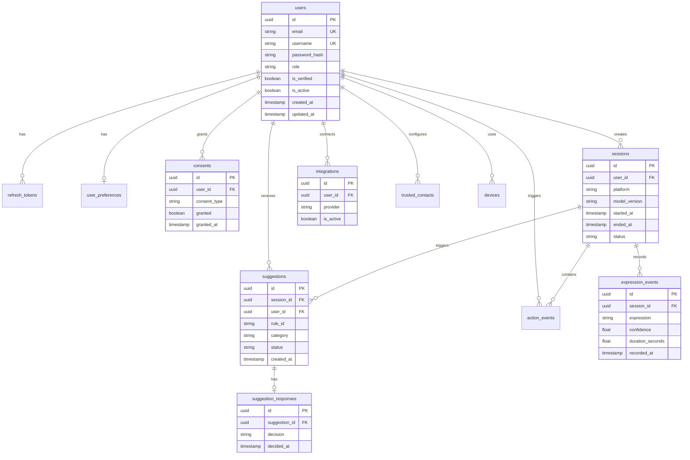

# MoodLens — Database Schema

## 1. Overview

- Database: PostgreSQL 15
- ORM: SQLAlchemy 2.0 (async)
- Migrations: Alembic
- All primary keys: UUID (uuid4)
- All timestamps: TIMESTAMP WITH TIME ZONE (UTC)

## 2. Table Definitions

### users
```
Column              Type                Nullable  Default      Constraints
------              ----                --------  -------      -----------
id                  UUID                NOT NULL  uuid_generate_v4()  PK
email               VARCHAR(320)        NOT NULL               UNIQUE
username            VARCHAR(50)         NOT NULL               UNIQUE
password_hash       VARCHAR(255)        NOT NULL
role                VARCHAR(20)         NOT NULL  'user'       CHECK(role IN ('user','developer','admin','support','security_auditor'))
is_verified         BOOLEAN             NOT NULL  false
is_active           BOOLEAN             NOT NULL  true
created_at          TIMESTAMPTZ         NOT NULL  NOW()
updated_at          TIMESTAMPTZ         NOT NULL  NOW()
```
Indexes: email (unique), username (unique), role, created_at

### refresh_tokens
```
Column              Type                Nullable  Default      Constraints
id                  UUID                NOT NULL               PK
user_id             UUID                NOT NULL               FK users.id ON DELETE CASCADE
token_hash          VARCHAR(255)        NOT NULL               UNIQUE
expires_at          TIMESTAMPTZ         NOT NULL
revoked             BOOLEAN             NOT NULL  false
device_fingerprint  VARCHAR(255)        NULL
created_at          TIMESTAMPTZ         NOT NULL  NOW()
```
Indexes: token_hash (unique), user_id, expires_at

### user_preferences
```
Column                  Type            Nullable  Default
id                      UUID            NOT NULL             PK
user_id                 UUID            NOT NULL             FK users.id ON DELETE CASCADE, UNIQUE
theme                   VARCHAR(10)     NOT NULL  'system'   CHECK(theme IN ('light','dark','system'))
notification_enabled    BOOLEAN         NOT NULL  true
quiet_hours_start       TIME            NULL
quiet_hours_end         TIME            NULL
suggestion_frequency    VARCHAR(20)     NOT NULL  'normal'   CHECK(suggestion_freq IN ('low','normal','high'))
music_genres            TEXT[]          NULL
preferred_playlists     TEXT[]          NULL
preferred_food_apps     TEXT[]          NULL
created_at              TIMESTAMPTZ     NOT NULL  NOW()
updated_at              TIMESTAMPTZ     NOT NULL  NOW()
```

### consents
```
Column          Type            Nullable  Default      Constraints
id              UUID            NOT NULL               PK
user_id         UUID            NOT NULL               FK users.id ON DELETE CASCADE
consent_type    VARCHAR(50)     NOT NULL               CHECK(consent_type IN (...))
granted         BOOLEAN         NOT NULL
granted_at      TIMESTAMPTZ     NULL
revoked_at      TIMESTAMPTZ     NULL
version         VARCHAR(10)     NOT NULL  '1.0'
ip_address      VARCHAR(45)     NULL
user_agent      TEXT            NULL
created_at      TIMESTAMPTZ     NOT NULL  NOW()
```
consent_types: camera_access, expression_processing, mood_suggestions, music_integration, food_suggestions, trusted_contacts, cloud_sync
Unique constraint: (user_id, consent_type) — one active consent record per type per user

### sessions
```
Column                  Type            Nullable  Default
id                      UUID            NOT NULL             PK
user_id                 UUID            NOT NULL             FK users.id ON DELETE CASCADE
device_id               VARCHAR(255)    NULL
platform                VARCHAR(20)     NOT NULL  'web'
model_version           VARCHAR(20)     NULL
started_at              TIMESTAMPTZ     NOT NULL  NOW()
ended_at                TIMESTAMPTZ     NULL
total_duration_seconds  INTEGER         NULL
status                  VARCHAR(20)     NOT NULL  'active'   CHECK(status IN ('active','completed','abandoned'))
created_at              TIMESTAMPTZ     NOT NULL  NOW()
```
Indexes: user_id, status, started_at

### expression_events
```
Column              Type            Nullable  Default
id                  UUID            NOT NULL             PK
session_id          UUID            NOT NULL             FK sessions.id ON DELETE CASCADE
expression          VARCHAR(20)     NOT NULL             CHECK(expression IN ('happy','sad','angry','fear','disgust','surprise','neutral','unknown','occluded','no_face'))
confidence          FLOAT           NOT NULL             CHECK(confidence >= 0.0 AND confidence <= 1.0)
duration_seconds    FLOAT           NOT NULL
quality_score       FLOAT           NULL
tracking_confidence FLOAT           NULL
model_version       VARCHAR(20)     NULL
recorded_at         TIMESTAMPTZ     NOT NULL  NOW()
```
Note: These are aggregated expression windows (e.g., 5-30 second intervals), NOT per-frame writes.
Indexes: session_id, expression, recorded_at

### suggestions
```
Column                  Type            Nullable  Default
id                      UUID            NOT NULL             PK
session_id              UUID            NOT NULL             FK sessions.id ON DELETE CASCADE
user_id                 UUID            NOT NULL             FK users.id ON DELETE CASCADE
rule_id                 VARCHAR(50)     NOT NULL
category                VARCHAR(30)     NOT NULL             CHECK(category IN ('music','wellness','food','sos'))
expression_trigger      VARCHAR(20)     NULL
confidence_at_trigger   FLOAT           NULL
requires_confirmation   BOOLEAN         NOT NULL  true
expires_at              TIMESTAMPTZ     NULL
status                  VARCHAR(20)     NOT NULL  'pending'  CHECK(status IN ('pending','accepted','dismissed','expired','ignored','disabled'))
created_at              TIMESTAMPTZ     NOT NULL  NOW()
```
Indexes: user_id, session_id, status, created_at

### suggestion_responses
```
Column          Type            Nullable  Default
id              UUID            NOT NULL             PK
suggestion_id   UUID            NOT NULL             FK suggestions.id ON DELETE CASCADE, UNIQUE
decision        VARCHAR(20)     NOT NULL             CHECK(decision IN ('accepted','dismissed','expired','ignored','disabled'))
decided_at      TIMESTAMPTZ     NOT NULL  NOW()
action_executed BOOLEAN         NOT NULL  false
```

### integrations
```
Column                  Type            Nullable  Default
id                      UUID            NOT NULL             PK
user_id                 UUID            NOT NULL             FK users.id ON DELETE CASCADE
provider                VARCHAR(30)     NOT NULL             CHECK(provider IN ('spotify','google','apple_music'))
access_token_encrypted  TEXT            NULL
refresh_token_encrypted TEXT            NULL
token_expires_at        TIMESTAMPTZ     NULL
scope                   TEXT[]          NULL
is_active               BOOLEAN         NOT NULL  true
created_at              TIMESTAMPTZ     NOT NULL  NOW()
updated_at              TIMESTAMPTZ     NOT NULL  NOW()
```
Unique: (user_id, provider)

### trusted_contacts
```
Column          Type            Nullable  Default
id              UUID            NOT NULL             PK
user_id         UUID            NOT NULL             FK users.id ON DELETE CASCADE
display_name    VARCHAR(100)    NOT NULL
phone_encrypted TEXT            NULL  -- AES-256 encrypted phone number
is_primary      BOOLEAN         NOT NULL  false
created_at      TIMESTAMPTZ     NOT NULL  NOW()
```
Max 5 trusted contacts per user (enforced in application layer)

### action_events
```
Column              Type            Nullable  Default
id                  UUID            NOT NULL             PK
session_id          UUID            NULL                 FK sessions.id ON DELETE SET NULL
user_id             UUID            NOT NULL             FK users.id ON DELETE CASCADE
action_type         VARCHAR(50)     NOT NULL
requires_confirm    BOOLEAN         NOT NULL  true
user_confirmed      BOOLEAN         NULL
confirmed_at        TIMESTAMPTZ     NULL
result              VARCHAR(50)     NULL
created_at          TIMESTAMPTZ     NOT NULL  NOW()
```
action_types: open_music, open_food_app, open_emergency_resource, initiate_call, send_message

### audit_logs
```
Column          Type            Nullable  Default
id              UUID            NOT NULL             PK
user_id_hash    VARCHAR(255)    NOT NULL  -- SHA-256 of user_id (not PII)
event_type      VARCHAR(50)     NOT NULL
action_id       VARCHAR(50)     NULL
model_version   VARCHAR(20)     NULL
source          VARCHAR(30)     NULL  -- 'user_confirmation', 'system', 'api'
result          VARCHAR(50)     NULL
metadata        JSONB           NULL  -- Non-PII context only
created_at      TIMESTAMPTZ     NOT NULL  NOW()
```
Retention: 365 days. Never log: raw video, biometric embeddings, phone numbers, access tokens.

### model_versions
```
Column              Type            Nullable  Default
id                  UUID            NOT NULL             PK
model_name          VARCHAR(50)     NOT NULL
version             VARCHAR(20)     NOT NULL
architecture        VARCHAR(50)     NOT NULL
accuracy_overall    FLOAT           NULL
macro_f1            FLOAT           NULL
balanced_accuracy   FLOAT           NULL
file_hash_sha256    VARCHAR(64)     NULL
quantization        VARCHAR(20)     NULL  -- 'fp32','fp16','int8'
supported_platforms TEXT[]          NULL
is_active           BOOLEAN         NOT NULL  false
release_date        DATE            NULL
notes               TEXT            NULL
created_at          TIMESTAMPTZ     NOT NULL  NOW()
```
Unique: (model_name, version)

## 3. Entity Relationship Diagram



## 4. Index Strategy

| Table | Index Column(s) | Type | Rationale |
|---|---|---|---|
| users | email | UNIQUE | Login lookup |
| users | username | UNIQUE | Username uniqueness |
| users | role | BTREE | Admin queries |
| refresh_tokens | token_hash | UNIQUE | Token validation |
| refresh_tokens | user_id | BTREE | User token cleanup |
| refresh_tokens | expires_at | BTREE | Expiry cleanup jobs |
| sessions | user_id | BTREE | User session list |
| sessions | status | BTREE | Active session queries |
| sessions | started_at | BTREE | History ordering |
| expression_events | session_id | BTREE | Session timeline |
| expression_events | recorded_at | BTREE | Time-based queries |
| expression_events | expression | BTREE | Expression frequency analytics |
| suggestions | user_id | BTREE | User suggestion history |
| suggestions | status | BTREE | Pending suggestion queries |
| consents | (user_id, consent_type) | UNIQUE | One record per type per user |
| integrations | (user_id, provider) | UNIQUE | One integration per provider |
| devices | device_fingerprint | UNIQUE | Device lookup |
| audit_logs | user_id_hash | BTREE | Audit queries by user |
| audit_logs | event_type | BTREE | Event type filtering |
| audit_logs | created_at | BTREE | Time-based audit queries |

## 5. Authorization Matrix (RBAC)

| Feature / Endpoint | USER | DEVELOPER | ADMIN | SUPPORT | SECURITY_AUDITOR |
|---|---|---|---|---|---|
| View own profile | ✅ | ✅ | ✅ | ❌ | ❌ |
| Update own profile | ✅ | ✅ | ✅ | ❌ | ❌ |
| Delete own account | ✅ | ✅ | ✅ | ❌ | ❌ |
| Create/manage sessions | ✅ | ✅ | ✅ | ❌ | ❌ |
| View own sessions | ✅ | ✅ | ✅ | ❌ | ❌ |
| Submit expression events | ✅ | ✅ | ✅ | ❌ | ❌ |
| Manage consents | ✅ | ✅ | ✅ | ❌ | ❌ |
| Respond to suggestions | ✅ | ✅ | ✅ | ❌ | ❌ |
| Connect integrations | ✅ | ✅ | ✅ | ❌ | ❌ |
| WebSocket subscribe | ✅ | ✅ | ✅ | ❌ | ❌ |
| API key management | ❌ | ✅ | ✅ | ❌ | ❌ |
| Webhook configuration | ❌ | ✅ | ✅ | ❌ | ❌ |
| View all users | ❌ | ❌ | ✅ | ✅ | ❌ |
| Manage user roles | ❌ | ❌ | ✅ | ❌ | ❌ |
| Deactivate users | ❌ | ❌ | ✅ | ✅ | ❌ |
| Model registry management | ❌ | ❌ | ✅ | ❌ | ❌ |
| View audit logs | ❌ | ❌ | ✅ | ✅ | ✅ |
| System metrics | ❌ | ❌ | ✅ | ✅ | ✅ |
| Bulk data operations | ❌ | ❌ | ✅ | ❌ | ❌ |

## 6. Complete API Specification

### Authentication Endpoints

#### POST /api/v1/auth/register
Auth: None
```json
Request: { "username": "alex", "email": "alex@example.com", "password": "SecurePass123!" }
Response 201: { "id": "uuid", "email": "...", "username": "...", "role": "user", "created_at": "..." }
Errors: 400 (validation), 409 (email/username exists)
```

#### POST /api/v1/auth/login
Auth: None
```json
Request: { "email": "...", "password": "..." }
Response 200: { "access_token": "...", "token_type": "bearer", "expires_in": 900 }
+ Set-Cookie: refresh_token=...; HttpOnly; Secure; SameSite=Strict; Path=/api/v1/auth/refresh
Errors: 401 (invalid credentials), 429 (rate limited)
```

#### POST /api/v1/auth/refresh
Auth: HttpOnly refresh token cookie
```json
Response 200: { "access_token": "...", "token_type": "bearer", "expires_in": 900 }
Errors: 401 (invalid/expired refresh token)
```

#### POST /api/v1/auth/logout
Auth: Bearer token
```json
Response 200: { "message": "Logged out successfully" }
+ Clears refresh token cookie
```

### User Endpoints

#### GET /api/v1/users/me
Auth: Bearer token, Role: any
```json
Response 200: { "id": "...", "email": "...", "username": "...", "role": "user", "is_verified": true, "created_at": "..." }
```

#### PATCH /api/v1/users/me
Auth: Bearer token
```json
Request: { "username": "new_name" } (partial update)
Response 200: { updated user object }
```

#### DELETE /api/v1/users/me
Auth: Bearer token
```json
Request: { "password": "confirm-with-password" }
Response 204: (no content, account deleted)
```

#### GET /api/v1/users/me/preferences
#### PATCH /api/v1/users/me/preferences

### Session Endpoints

#### POST /api/v1/sessions
Auth: Bearer token
```json
Request: { "device_id": "browser-fingerprint", "platform": "web", "model_version": "1.0.0" }
Response 201: { "session_id": "uuid", "created_at": "..." }
```

#### GET /api/v1/sessions
Auth: Bearer token
Query: ?page=1&limit=20&status=completed
```json
Response 200: { "items": [...], "total": 50, "page": 1, "pages": 3 }
```

#### GET /api/v1/sessions/{session_id}
#### PATCH /api/v1/sessions/{session_id} (end session)

#### POST /api/v1/sessions/{session_id}/events
Auth: Bearer token (must own session)
```json
Request: { "events": [{ "expression": "sad", "confidence": 0.87, "duration_seconds": 8.2, "quality_score": 0.94, "recorded_at": "..." }] }
Response 201: { "recorded": 1 }
```

#### GET /api/v1/sessions/{session_id}/events

### Suggestion Endpoints

#### POST /api/v1/suggestions/{suggestion_id}/respond
Auth: Bearer token (must own suggestion)
```json
Request: { "decision": "accepted" }
Response 200: { "suggestion_id": "...", "decision": "accepted", "decided_at": "..." }
```

### Consent Endpoints

#### GET /api/v1/consents
#### POST /api/v1/consents
```json
Request: { "consent_type": "music_integration", "granted": true }
Response 201: { consent object }
```
#### DELETE /api/v1/consents/{consent_type} (revoke)

### Integration Endpoints

#### GET /api/v1/integrations
#### GET /api/v1/integrations/spotify/auth-url
```json
Response 200: { "auth_url": "https://accounts.spotify.com/authorize?...", "state": "csrf-token" }
```
#### POST /api/v1/integrations/spotify/callback
```json
Request: { "code": "...", "state": "...", "code_verifier": "..." }
Response 200: { "connected": true, "scopes": [...] }
```
#### DELETE /api/v1/integrations/spotify

### Admin Endpoints (ADMIN role required)

#### GET /api/v1/admin/users
#### PATCH /api/v1/admin/users/{user_id}
#### GET /api/v1/admin/model-versions
#### POST /api/v1/admin/model-versions
#### PATCH /api/v1/admin/model-versions/{id}/activate
#### GET /api/v1/admin/audit-logs

### WebSocket

#### WS /api/v1/ws/{session_id}
Auth: First message must be { "type": "auth", "token": "access_token" }

Message types (client → server):
- { "type": "auth", "token": "..." }
- { "type": "expression_update", "expression": "sad", "confidence": 0.87, "quality": 0.94, "timestamp": "..." }
- { "type": "suggestion_response", "suggestion_id": "...", "decision": "accepted" }
- { "type": "ping" }
- { "type": "session_end" }

Message types (server → client):
- { "type": "ready", "session_id": "..." }
- { "type": "suggestion", "suggestion_id": "...", "category": "music", "message": "...", "requires_confirmation": true, "expires_in": 30 }
- { "type": "pong" }
- { "type": "error", "code": "...", "message": "..." }
